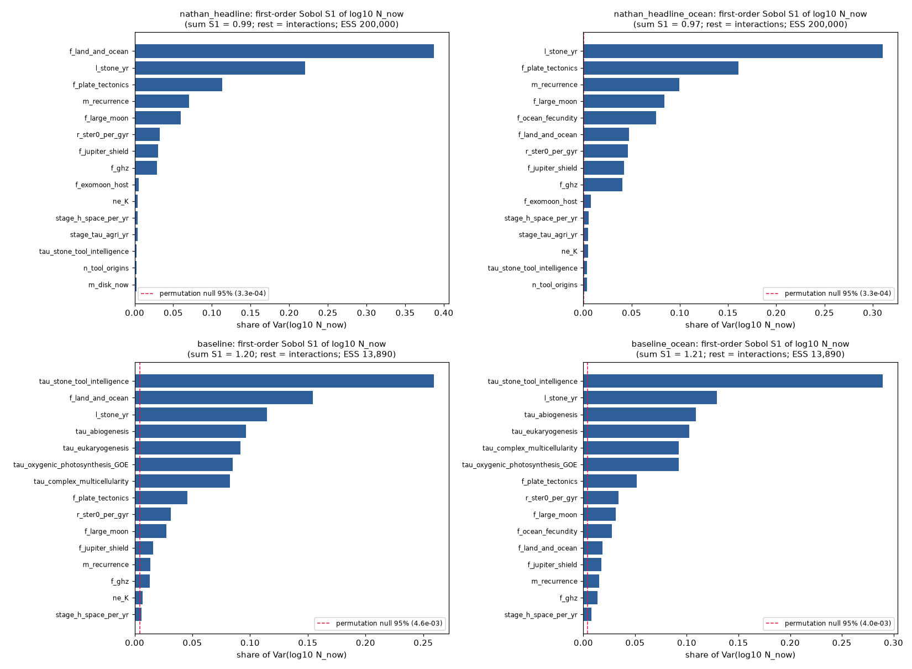
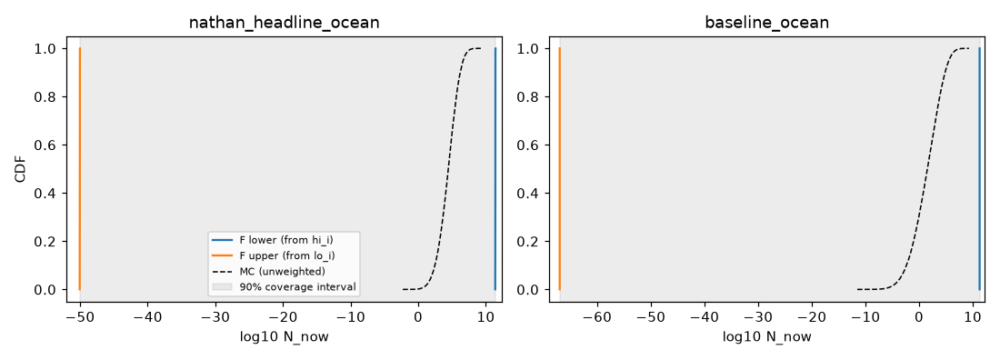

# Rigor add-on (2026-10-19, extended 2026-10-26)

**Headline metric (from 2026-10-26):** the median number of radio-or-better civilizations (radio plus spacefaring stages) that exist now in the Milky Way. Worlds with stone-age-or-greater tool users (N_now) are kept as a secondary number. Sections 1–7 below were written for N_now; section 8 uses the new headline.

## 1. Guaranteed bounds on N_now over the full prior support

Method: python-flint 0.9.0 (Arb ball arithmetic, 128-bit). Every factor is set to the full support of its prior. Two normal priors with no upper limit (`sfr_now`, `m_disk_now`) are cut at mean + 6 sd; without that cut the upper bound is infinite, because N is linear in disk mass. The bounds apply to the continuous-time model equations. They are made conservative with the inequalities listed below. All 200,000 MC samples of each scenario fall inside them. **The bounds answer "what is logically possible under these priors", not "what is likely".** Their width (about 60–80 dex) is the honest size of the prior support; the MC 10–90% range is what the priors' *shapes* imply.

| scenario | guaranteed min | guaranteed max | bound width (dex) | MC median | MC 10–90% | MC width (dex) |
|---|---|---|---|---|---|---|
| `nathan_headline` | 1.75e-53 | 2.1e+11 | 64.1 | 2.39e+03 | 12.8–3.55e+05 | 4.44 |
| `nathan_headline_ocean` | 2.01e-53 | 2.77e+11 | 64.1 | 2.82e+04 | 294–1.62e+06 | 3.74 |
| `baseline` | 3.85e-71 | 1.21e+11 | 81.5 | 0.00357 | 8.58e-07–11.1 | 7.11 |
| `baseline_ocean` | 4.53e-71 | 1.92e+11 | 81.6 | 0.0413 | 1.45e-05–83.9 | 6.76 |

Conservative steps (each one can only widen the interval):

* Q(a) = (g*K)(a) <= cdf_g(a) <= prod_j P(X_j <= a)  (K<=1; each X_j <= sum of steps)
* cdf_g(a) >= max over splits a=sum a_j of prod_j P(X_j <= a_j)  (all X_j <= a_j implies sum <= a); splits: equal, proportional to tau_hi
* K(s) = pi_on + (1-pi_on)exp(-s/Lp) >= pi_on = beta/(alpha+beta), alpha = 1/(mean episode length) <= alpha_base + max_s h_s (exit rate from any stage <= alpha_base + (1-q) h_s)
* sterilisation survival exp(-(H_now-H(t))) in [exp(-H_now_max), 1], H_now = r_ster0 * M_formed / (sfr_now * 1e9 yr)
* metallicity ramp fZ <= 1; lower bound uses fZ at the oldest formation time of the chosen age window
* upper bound: all stars ever formed (M_formed) counted with Q <= Q_max(th_c); lower bound: only thin-disk planets with ages in one window [a_lo,a_hi] inside every class's window
* thin-disk exponent k from (exp(kD)-1)/k = target is monotone in target and D; window mass monotone in k; k clamped to [-20,20] as in solve_k
* superhabitability: (1-f)m + f*min(m*b,1) in [m, m*b_max] for m <= 1
* ocean path: land fraction L plus ocean fraction O=min(Ow,1-L)*fec lies in [L_lo + min(Ow_lo,1-L_hi)*fec_lo, min(1, L_hi + Ow_hi*fec_hi)]
* dependent quantities (sfr_now in both target and window mass, etc.) treated as independent intervals: only widens bounds

The lower bound is small mainly because of three things at their worst corners: the occupancy floor pi_on (the shortest stone-age lifetime and the highest stage hazards), the hard-step completion probability (tau up to 1e3 Gyr in the baseline), and every multiplier at its low end.

## 2. Held-out testing

**No factor in the model is fitted.** There is no regression, curve fit or optimiser in the code. The thin-disk star-formation exponent is solved exactly from prior draws, not fitted to data; the habitable-zone occurrence rates and the star-formation history are literature priors. So there is no fitted trend to hold out. Only two quantities are *estimated* from Archive data here, and both got a 50/50 split check:

* **`f_superhab` best value 0.104** = P(size) × P(temp), assuming the two are independent (n = 49 HZ planets with R < 2; 25 pass size, 10 pass temperature, 3 pass both, so the joint fraction is 0.061). Over 5000 random 50/50 splits, each estimator was fitted on one half and scored by absolute error against the other half's joint frequency, with Bonferroni correction for m = 3 comparisons:
  * vs joint frequency (1 param): mean abs error 0.057 vs 0.059; product better in 51% of splits; Bonferroni p = 1.00
  * vs prior-bracket midpoint 0.114 (0 params): mean abs error 0.057 vs 0.054; product better in 52% of splits; Bonferroni p = 1.00
  * vs random null (2 params, U(0,1) x U(0,1)): mean abs error 0.057 vs 0.209; product better in 76% of splits; Bonferroni p = 0.71
  * Verdict: the independence-product estimator does **not** beat trivial baselines and is not significantly better than an equal-parameter random null. The 0.104 best value is not supported over the direct joint fraction (0.061). Both lie inside the prior bracket 0.03–0.43, which is unchanged. Its first-order Sobol share is <0.1%, so this does not move N.
* **ESI weight (pooled list, n = 26)**: split-half difference of the mean ESI, median 0.017, 95th percentile 0.049, which is ≤ 0.012 dex in N. Stable; this is a descriptive check (not a prediction test).
* **ESI weight (M list, n = 22)**: split-half difference of the mean ESI, median 0.020, 95th percentile 0.056, which is ≤ 0.014 dex in N. Stable; this is a descriptive check (not a prediction test).

## 3. Leakage check

* **Earth's timeline.** In the headline and its ocean variant the step times are *set* to Earth's intervals and the Earth-timing likelihood is switched off (`bayes_update: false`), so Earth's dates are used once, as a prior. In the baselines the dates are used once, as a likelihood, with the observer-selection normalisation (divide by P(completion within Earth's window)); this is present in the code: True. No double use. The headline is still *conditional on Earth being typical*: that is an assumption, not leakage.
* **N includes Earth.** The target (tool-using worlds now) contains Earth, and the inputs use Earth's history. Nothing conditions on N ≥ 1, so the reported P(N<1) is a prior-predictive number, not a probability given that we exist.
* **ESI weighting.** The lists are Archive exoplanets only (Solar System bodies present: False). Earth enters only as the ESI reference point. ESI's temperature term comes from insolation, and the habitable-zone cut behind ne also uses insolation, so the HZ condition is partly applied twice. That is a mild double penalty, not target leakage, and it is small (ESI weights 0.74–0.94).
* **Tool-use counts.** `n_tool_origins` includes hominins (True), whose own first stone tools fix the 0.597 Gyr interval that is divided by n. The same Earth record therefore sets both the interval and one of the counts. This is a soft circularity: Earth's success is part of the evidence that tool use is repeatable. Its effect on N is small (first-order Sobol share ≈ 0.3%).
* **Model outputs or SETI results used as inputs:** False / False. None found.

## 4. Evidence tags

Each sourced variable in `params.yaml` now has a `tag:` set to [MEASURED], [MODELED] or [GUESS], and the tag is shown in the README provenance table. The mapping: ASSUMED and user-supplied become [GUESS]; literature + ASSUMED element becomes [MODELED]; literature-sourced is [MEASURED] for censuses, surveys and dated records, else [MODELED]. The SDO 2018 Table-1 ranges are tagged [GUESS], because they compile published opinions.

## 5. Sensitivity ranking (first-order Sobol share of Var(log10 N_now))

| rank | `nathan_headline` | `nathan_headline_ocean` | `baseline` | `baseline_ocean` |
|---|---|---|---|---|
| 1 | f_land_and_ocean 0.39 | l_stone_yr 0.31 | tau_stone_tool_intelligence 0.26 | tau_stone_tool_intelligence 0.29 |
| 2 | l_stone_yr 0.22 | f_plate_tectonics 0.16 | f_land_and_ocean 0.15 | l_stone_yr 0.13 |
| 3 | f_plate_tectonics 0.11 | m_recurrence 0.10 | l_stone_yr 0.11 | tau_abiogenesis 0.11 |
| 4 | m_recurrence 0.07 | f_large_moon 0.08 | tau_abiogenesis 0.10 | tau_eukaryogenesis 0.10 |
| 5 | f_large_moon 0.06 | f_ocean_fecundity 0.08 | tau_eukaryogenesis 0.09 | tau_complex_multicellularity 0.09 |
| 6 | r_ster0_per_gyr 0.03 | f_land_and_ocean 0.05 | tau_oxygenic_photosynthesis_GOE 0.09 | tau_oxygenic_photosynthesis_GOE 0.09 |
| 7 | f_jupiter_shield 0.03 | r_ster0_per_gyr 0.05 | tau_complex_multicellularity 0.08 | f_plate_tectonics 0.05 |
| 8 | f_ghz 0.03 | f_jupiter_shield 0.04 | f_plate_tectonics 0.05 | r_ster0_per_gyr 0.03 |
| sum S1 | 0.99 | 0.97 | 1.20 | 1.21 |

Given-data estimator with 50 quantile bins on the existing 2e5 samples (importance-weighted for the baselines, effective sample size ≈ 13,900). The permutation-null noise floor is ≤ 0.005. Sum S1 < 1 means interactions. In the baselines the sum exceeds 1 because the Earth-timing posterior correlates the step times, and first-order Sobol assumes independent inputs; read those values as a ranking only. `p_ocean_to_industrial` does not appear because it changes only the stage split, not N_now.

## 6. v2 additions (Oct 19)

**Linked inputs** (`links:` in params.yaml, Gaussian copula on shared hidden log-space variables; every link strength is [GUESS]). The groups are geology (plate tectonics, land+ocean, rocky composition), water (ocean-world fractions, with land+ocean anti-linked), civ_risk (stage hazards and r_self), galactic_env (SN, GRB, sterilisation rates) and M-dwarf activity. Weighted median (10–90%), 2e5 draws:

| scenario | unlinked | linked |
|---|---|---|
| `nathan_headline_ocean` | 2.82e+04 (294–1.62e+06) | 2.9e+04 (272–1.85e+06) |
| `baseline_ocean` | 0.0413 (1.45e-05–83.9) | 0.043 (1.56e-05–95.9) |

Links leave the supports unchanged, so they cannot change any guaranteed bound. The p-box below holds for any dependence among the guesses.

**Guaranteed bounds, tightened** (`engine.py` + `bnb.py`, python-flint/Arb). Changes: an exact hypoexponential CDF at the monotone τ corners; an occupancy floor from the kernel K(a) rather than π_on alone; a bound on the episode end rate using the lithic-stage residence time (stage 1 carries no extra hazard); and branch-and-bound over 60 splits per tail. These are rigorous for the model equations.

| scenario | old min | new min | old max | new max | width old→new (dex) |
|---|---|---|---|---|---|
| `nathan_headline_ocean` | 2.01e-53 | 2.52e-47 | 2.77e+11 | 2.75e+11 | 64.1→58.0 |
| `baseline_ocean` | 4.53e-71 | 7.78e-64 | 1.92e+11 | 1.92e+11 | 81.6→74.4 |
| `nathan_headline` | 1.75e-53 | 9.63e-49 | 2.1e+11 | 2.07e+11 | 64.1→59.3 |
| `baseline` | 3.85e-71 | 2.97e-65 | 1.21e+11 | 1.21e+11 | 81.5→75.6 |

The upper bound is a product of monotone factors at their worst corner, which is already attained, so branch-and-bound cannot lower it further.

**Binding factors** = the factors whose restriction to the half away from their worst end tightens that tail bound most (gain in dex):

- `nathan_headline_ocean`: low tail is set by r_ster0_per_gyr (high end, 42.42), sfr_now (low end, 30.0), m_disk_now (high end, 17.73); high tail is set by f_plate_tectonics (high end, 1.0), f_large_moon (high end, 0.62), f_jupiter_shield (high end, 0.47).
- `baseline_ocean`: low tail is set by r_ster0_per_gyr (high end, 42.42), sfr_now (low end, 30.0), m_disk_now (high end, 17.73); high tail is set by f_plate_tectonics (high end, 1.0), f_large_moon (high end, 0.53), f_jupiter_shield (high end, 0.42).

**P-box** (`pbox.py`, ). The [MEASURED]/[MODELED] inputs are drawn from their priors (2000 stored draws). Each [GUESS] or untagged input is held as its whole interval, which gives a rigorous [lo_i, hi_i] per draw. The coverage interval uses two-sided DKW at 95% confidence.

| scenario | 90% coverage interval (if every guess range is honest) | hard interval, MEASURED/MODELED only, guesses fixed at medians |
|---|---|---|
| `nathan_headline_ocean` | [9.12e-51, 2.63e+11] | [2.29e+03, 8.58e+05] |
| `baseline_ocean` | [1.12e-67, 1.92e+11] | [1.49e+03, 6.27e+05] |

The coverage interval is almost as wide as the hard bounds, so the [GUESS] ranges alone account for nearly all of the 60+ dex. The per-draw boxes are not branch-and-bounded, which is why the lower end sits below the tightened hard minimum. The baseline p-box uses unweighted prior draws: its step times are [GUESS] intervals, so the Earth-timing weights cannot be applied rigorously.

**Faster sampling** (`qmc.py`). The estimate is E[log10 N_now], unweighted, from 16 replicates of 4096 draws. Scrambled Sobol is used for all inverse-CDF inputs; the ESI bootstrap stays pseudo-random. The control variate is the sum of the log10 loguniform inputs, whose mean is exact.

| scenario | var. reduction: MC+CV | Sobol | Sobol+CV |
|---|---|---|---|
| `nathan_headline_ocean` | 1.22× | 63× | 63× |
| `baseline_ocean` | 1.38× | 5555× | 5555× |

At equal cost, the variance reduction equals the speedup. The control variate adds nothing on top of Sobol, because scrambled Sobol already integrates the linear term almost exactly. Caching the unchanged stages (solve_k, stage chain, step DFTs) in a pick-freeze run (2000 draws, base run plus 5 factors) took 32.84 s down to 13.14 s, a 2.5× speedup with a 79% hit rate, and the output was bit-identical.

**Independent check** (`check.py`). It does not import drake_model. It uses time-domain convolutions, its own root finder and its own stage-chain solve, working only from the formulas and params.yaml.

| scenario | draws checked | max rel. error in N | max abs. error in logw | p10 / p50 / p90 | support violations | samples outside new bounds |
|---|---|---|---|---|---|---|
| `nathan_headline_ocean` | 1000 | 5.4e-13 | 0.0e+00 | 294 / 2.82e+04 / 1.62e+06 | 0 | 0 |
| `baseline_ocean` | 1000 | 3.4e-12 | 4.2e-12 | 1.45e-05 / 0.0413 / 83.9 | 0 | 0 |

No mismatches were found, so there were no bugs to fix.

## 7. v3 features (Oct 21): star multiplicity cut (A) and multi-moon civilisations (B)

Paired runs of 1e5 draws each. The new inputs come from their own random stream, so every other draw is identical to the parent's first 1e5 draws. Medians are weighted for the baseline. The parent row is the parent's own first 1e5 draws.

| run | median (10–90%) | radio-capable median | paired median change (dex) | share of N in multi-civ systems |
|---|---|---|---|---|
| `nathan_headline_ocean_parent_1e5` | 2.82e+04 (293–1.63e+06) | 61.7 |  |  |
| `nathan_headline_ocean_mult` | 2.58e+04 (267–1.49e+06) | 56.1 | -0.039 |  |
| `nathan_headline_ocean_moons` | 3.17e+04 (329–1.82e+06) | 69.3 | +0.006 | 3.4% |
| `nathan_headline_ocean_ab` | 2.9e+04 (301–1.66e+06) | 62.9 | -0.029 | 2.6% |
| `baseline_ocean_parent_1e5` | 0.0388 (1.34e-05–80.5) | 8.02e-05 |  |  |
| `baseline_ocean_mult` | 0.0357 (1.24e-05–73.9) | 7.28e-05 | -0.038 |  |
| `baseline_ocean_moons` | 0.043 (1.54e-05–90.4) | 8.94e-05 | +0.006 | 7.2% |
| `baseline_ocean_ab` | 0.0395 (1.42e-05–82) | 8.17e-05 | -0.028 | 5.1% |

**A. Multiplicity cut.** Habitable worlds are allowed only in single or binary systems; binaries are still handled by the existing `f_binary_ok`. A fraction `f_hab_triple_plus` of triple-or-higher systems is let through: [GUESS], loguniform 1e-3–0.3. Each host type c gets the factor 1 − f_triple_plus_c·(1 − f_hab_triple_plus). The triple-or-higher fractions (THF) are:
- M: 2.6–7.7%, [MEASURED], from Winters+2019 via Offner+2023 PPVII Table 1.
- K: 6.3–12%, [MODELED], bracketed between the table's 0.3–0.6 and 0.75–1.25 Msun rows. This is consistent with Raghavan+2010 (8% triple + 3% higher).
- G: 10–14%, [MEASURED].
- F: 12–16%, [MEASURED].

Double counting: `f_binary_ok` removes close binaries (<47 au, Kraus+2016) from all stars. Triples are a separate category of system, so the two cuts act on different configurations. However, a triple with a close inner pair could be removed by both, because the model treats the two cuts as independent. That overlap can over-remove at most the triple fraction (≤16%, ≤0.08 dex). THF counts systems by their primary; companions in the same system are not counted separately.

**B. Multi-moon civilisations.** Each giant that hosts a habitable moon has `n_hab_moons_per_giant` = k habitable moons: [MODELED], uniform 1–3. Grounding: Jupiter has 4 large moons and Saturn has 1; Cilibrasi+2018 find surviving systems most often have 3 moons, with a maximum of 5. The upper limit of 3 is assumed. Expected civilisation-bearing moon worlds scale by k·(1+(k−1)·p_second_civ). The first civilisation can arise on any of the k moons, which is accurate for small occupancy. After that, each other moon gets a civilisation with probability `p_second_civ` [GUESS], loguniform 1e-3–0.5, through impact transfer.

Worlds in multi-civilisation systems are counted as N_moon·(E[X] − P(X=1))/E[X], where X = 1 + Bin(k−1, p2). N_now counts worlds, so `p_dominance` [GUESS] does not reduce N_now: an absorbed world is still occupied. It reduces only the number of independent civilisations, N_civ_now (median 3.15e4 headline_ocean_moons, 0.0427 baseline_ocean_moons). `tech_accel` [GUESS], loguniform 1–10, divides the industrial→radio→spacefaring advance times and the industrial and radio hazards. It applies only to multi-civilisation worlds and changes the stage split (radio-capable). Its effect on episode length, and therefore on N_now, is left out, which is conservative. Planet–planet multi-civilisation systems are not modelled.

## 8. New variables, first pass (Oct 26; superseded by section 9, which removes the [GUESS]-based ones)

Each variant is paired with its `*_linked` parent: all new inputs come from their own random stream. The variant `_v4` contains every new variable except interstellar expansion; `_v4x` adds expansion. Both use 1e5 draws, and each single-variable variant uses 5e4. Baseline numbers are weighted by Earth's timing.

| run | radio-or-better median (10–90%) | P(radio-or-better < 1) | stone-age-or-greater median |
|---|---|---|---|
| `nathan_headline_ocean_linked` (parent) | 62 (0.0293–8.39e+04) | 0.25 | 2.92e+04 |
| `nathan_headline_ocean_linked_v4` | 3.57 (0.00189–5.31e+03) | 0.42 | 1.5e+05 (6.74e+03 without the subsurface path) |
| `nathan_headline_ocean_linked_v4x` (with expansion) | 243 (0.00249–3.89e+09) | 0.33 | 6.46e+05 |
| `baseline_ocean_linked` (parent) | 8.06e-05 (3.95e-09–1.27) | 0.89 | 0.0398 |
| `baseline_ocean_linked_v4` | 8.9e-06 (5.11e-10–0.141) | 0.94 | 0.382 (0.0198 without the subsurface path) |
| `baseline_ocean_linked_v4x` (with expansion) | 0.0015 (1.02e-09–2.37e+07) | 0.63 | 4.62 |

**Each variable alone** (paired dex shift in radio-or-better: median of the per-draw log ratio / shift of the median / shift of the 90th percentile):

| variable | headline_ocean_linked | baseline_ocean_linked |
|---|---|---|
| metal | -0.26 / -0.26 / -0.26 | -0.26 / -0.26 / -0.24 |
| ghz | +0.00 / +0.05 / +0.04 | +0.00 / +0.09 / +0.14 |
| oxygen | -0.04 / -0.07 / -0.07 | -0.05 / -0.07 / -0.07 |
| recovery | -0.20 / -0.31 / -0.22 | -0.00 / -0.04 / -0.07 |
| resources | -0.65 / -0.66 / -0.64 | -0.65 / -0.63 / -0.61 |
| climate | -0.12 / -0.13 / -0.12 | -0.12 / -0.14 / -0.11 |
| subsurface | +0.00 / +0.08 / +0.02 | +0.00 / +0.05 / +0.05 |
| expansion | +0.13 / +0.84 / +4.50 | +0.12 / +1.28 / +6.39 |

**Sobol top drivers of log10 radio-or-better** (first-order, `_v4`): headline l_stone_yr 0.34, stage_h_space_per_yr 0.23, f_land_and_ocean 0.14, f_plate_tectonics 0.08, stage_h_ind_per_yr 0.04; baseline l_stone_yr 0.21, tau_stone_tool_intelligence 0.18, stage_h_space_per_yr 0.14, f_land_and_ocean 0.08, tau_abiogenesis 0.07. With expansion (`_v4x`), `v_front_c` enters the headline top 6. The S1 sums exceed 1 because linked and Bayes-updated inputs are correlated, so read these as rankings only.

**How each variable enters the model** (tags are in params.yaml):
- **Metallicity / phosphorus.** Factor (1+(R−1)·f_rich,gal)/(1+(R−1)·0.48) × f_P. R is the terrestrial-planet occurrence ratio, metal-rich vs metal-poor, [MEASURED] 1.72 +0.19/−0.17 (Wang & Fischer 2015). 0.48 is the metal-rich share of their Kepler sample. The galactic metal-rich fraction is [GUESS]; Hayden+2015 APOGEE gives the shape of the metallicity distribution but no galaxy-wide fraction. f_P is [GUESS] (Hinkel+2020: the Sun is relatively P-rich, and P is measured in only ~100 stars). Almost the whole shift comes from f_P.
- **GHZ with radial migration.** r_ster0 = astrophysical [MODELED, Barnes+2026 galaxy-wide 1e-5–2e-4/Gyr] + non-astrophysical [GUESS 1e-6–0.25]. Each star's exposure is spread lognormally around the galaxy mean (log-sd [GUESS], smoothed by migration σ_RM8 = 3.6 kpc; Frankel+2018), and N is averaged over that spread. **The astrophysical part is now constrained to ≤2e-4/Gyr, but the low-tail risk sits in the assumed non-astrophysical part (giant impacts, runaway climate), which no GHZ data constrain.** Net effect: the median barely moves; the low tail rises slightly (p10 +0.04 to +0.06 dex, p01 up to +0.18 dex).
- **Oxygenation timing.** Industry needs O2 at fire level. Earth reached it about 0.17 Gyr after complex multicellularity: 0.6 Ga to earliest charcoal ~0.43 Ga, with sustained fires needing ≥16% (Geology 50:1048, 2022; Belcher & McElwain 2008). The NOE is dated 0.85–0.54 Ga and the GOE ~2.4 Ga (Lyons+2014); the GOE is already a hard step. The lag scale and the never-oxygenated fraction are [GUESS]. Tool-user occupancy before the lag cannot industrialise. The gate applies to both the land path and the ocean path, the latter on top of p_ocean_to_industrial.
- **Recovery time.** 5–20 Myr [MODELED, Kirchner & Weil 2000: ~10 Myr origination lag] is added to the tool-use re-evolution time. It matters only when re-evolution is fast, as in the headline.
- **Fuel/ore** [GUESS 0.05–1] gates industry. **Climate thermostat** [GUESS 0.5–1] is linked to the geology hidden variable (0.5); Foley & Smye 2018 give the context: stagnant-lid planets stay temperate for 1–5 Gyr only in limited parameter ranges.
- **Subsurface oceans** are a separate path. Number per star is [GUESS 0.1–10], with context from Solar System ocean moons and Sumi+2023 (21 free-floating planets per star). Fecundity is [GUESS 1e-6–1e-2] and the chance of reaching technology is [GUESS 1e-6–1e-3]. This path has no rare-Earth factors, so it dominates the stone-age count under these guesses (~96% by mean) but adds nothing to radio-or-better at the median.
- **Interstellar expansion** (Carroll-Nellenback+2019 settlement fronts). Each expanding spacefaring civilisation holds on average ρ·f·(4π/3)(v·L)³/4 settled systems while it is spacefaring, capped at f × N_stars. ρ = 0.08 pc⁻³ (their value, citing Henry+2018). v is [MODELED]: 1e-3–0.1 c probes, with a ~100 km/s floor from stellar motions. f and p_expand are [GUESS]. **Settled worlds make up almost all of the radio-or-better mean when expansion is on**: the 90th percentile rises by 4.5–6.4 dex. Settlements are assumed to end with their parent's spacefaring phase, which is conservative.

## 9. v5: only the data-anchored new variables (Oct 26, current)

Removed from the section-8 set because their effect rests on [GUESS] ranges: fossil fuel/ores, the phosphorus part of the metallicity variable, climate thermostat, subsurface/rogue habitats, and interstellar expansion. The older model's own [GUESS] factors are unchanged; this pass covers only the new batch. The oxygen gate now applies to the land path only. The ocean path already has `p_ocean_to_industrial`, so gating it again would double-count. Each `_v5` variant is paired with its `*_linked` parent: 1e5 draws, single-variable runs 5e4.

| run | radio-or-better median (10–90%) | P(radio-or-better < 1) | stone-age-or-greater median |
|---|---|---|---|
| `nathan_headline_ocean_linked` (parent) | 62 (0.0293–8.39e+04) | 0.25 | 2.92e+04 |
| `nathan_headline_ocean_linked_v5` | 32.2 (0.016–5.09e+04) | 0.29 | 1.57e+04 |
| `baseline_ocean_linked` (parent) | 8.06e-05 (3.95e-09–1.27) | 0.89 | 0.0398 |
| `baseline_ocean_linked_v5` | 7.75e-05 (4.54e-09–1.1) | 0.90 | 0.0403 |

| variable alone (paired dex shift, radio-or-better: per-draw median / median / p90) | headline | baseline |
|---|---|---|
| metal | -0.04 / -0.04 / -0.04 | -0.04 / -0.05 / -0.04 |
| ghz | +0.00 / +0.04 / +0.03 | +0.00 / +0.06 / +0.04 |
| oxygen | -0.00 / -0.00 / -0.00 | -0.01 / -0.01 / -0.01 |
| recovery | -0.17 / -0.28 / -0.20 | -0.00 / -0.03 / -0.06 |

**Top 5 Sobol drivers of log10 radio-or-better** (`_v5`): headline l_stone_yr 0.34, stage_h_space_per_yr 0.23, f_land_and_ocean 0.17, f_plate_tectonics 0.10, stage_h_ind_per_yr 0.04; baseline l_stone_yr 0.21, tau_stone_tool_intelligence 0.18, stage_h_space_per_yr 0.14, f_land_and_ocean 0.09, f_plate_tectonics 0.07.

**Inputs and how the ranges were set:**
- **Metallicity occurrence.** R is [MEASURED] 1.72 +0.19/−0.17, the terrestrial-planet occurrence ratio for metal-rich vs metal-poor stars (Wang & Fischer 2015). The galactic metal-rich fraction is [MODELED] uniform 0.023–0.607. That range spans the six Hayden+2015 Table 1 midplane bins (R = 3–15 kpc), each converted to P([Fe/H] > 0.05) with a Gaussian(mean, σ) approximation. Any mass weighting of the bins must lie inside that span. Kepler-field reference: 0.48.
- **GHZ + migration.** The star-to-star exposure spread s is [MODELED] uniform 0–√2. These are bounds, not a fit: 0 means complete radial mixing; √2 is the spread an exponential disk gives with no migration. Migration (Frankel+2018, 3.6 kpc over 8 Gyr) puts the truth between them. r_ster0 keeps its existing prior.
- **Oxygenation.** The lag is [MEASURED] uniform 0.17–0.18 Gyr, spanning only the two sourced Earth anchors: complex multicellularity at 0.6 Ga, then the earliest charcoal (needing ≥16% O2) at ~0.43 Ga (Geology 2022) and ~0.42 Ga (Scott & Glasspool 2006). The previous [GUESS] spread and the never-oxygenated fraction were dropped. Applies to the land path only.
- **Recovery.** Fixed at 10 Myr [MEASURED] (Kirchner & Weil 2000). The earlier 5–20 Myr spread was an assumption and has been removed.
