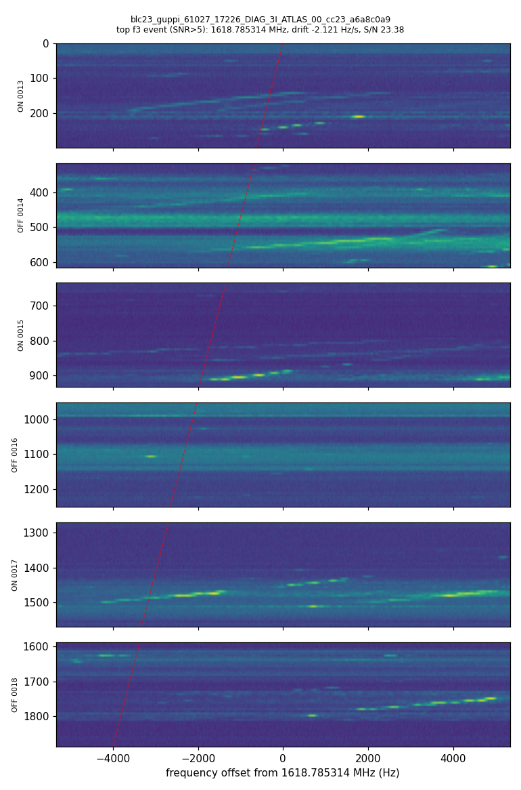
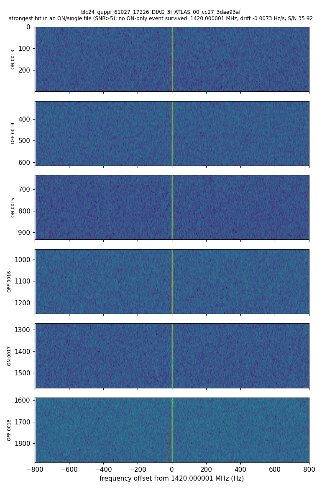
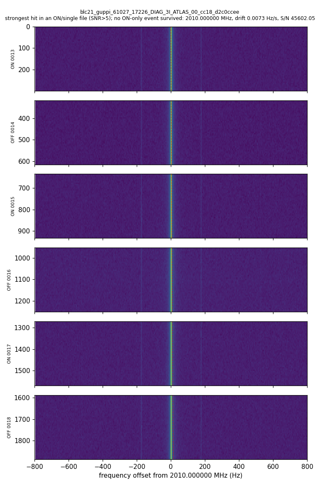
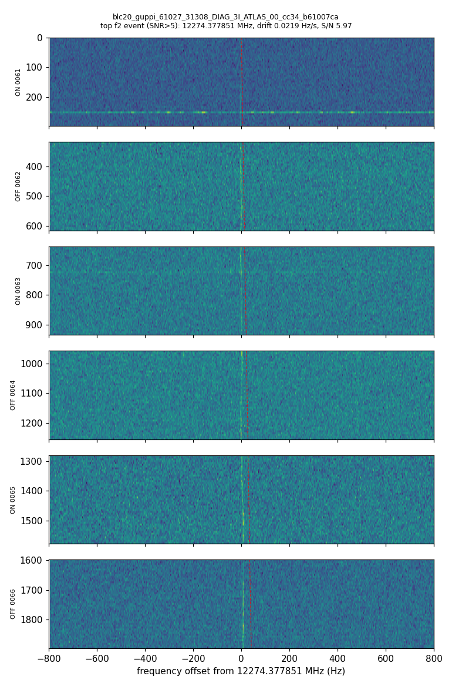

# SETI scan log (Breakthrough Listen open data)

Generated by `seti/scan.py` on 2026-11-02T08:57:11-07:00 (America/Phoenix). Queue: 4 done, 0 pending, 1 failed.

**Caveats (read these first).** Every hit and every "event" below is almost certainly radio-frequency interference (RFI) or noise. No detection is claimed. turboSETI hits are simply narrowband features above an S/N threshold, and the ON-OFF test only removes signals that also appear in the OFF pointings; a filter-3 event would still need checks against known RFI, a look at the waterfall, and above all re-observation at a later date before it means anything. The S/N 5 runs are deliberately below the usual BL threshold (10) and are dominated by noise fluctuations. These are tiny slices (one ~2.9 MHz coarse channel per file) of public data that BL has already searched; BL reported no technosignature in them.

## 3I/ATLAS GBT L-band (1618.65-1621.58 MHz, Iridium/GNSS region): blc23 scans 0013-0018, coarse channel 23

* Job id `blc23_guppi_61027_17226_DIAG_3I_ATLAS_00_cc23_a6a8c0a9`, kind `bl_h5_cadence`, coarse channel 23; run 2026-10-06T01:51:51-07:00 → 2026-10-06T01:51:57-07:00 (0.1 min); data pulled ≈ 912.2 MB.
* turboSETI FindDoppler: max |drift| 4.0 Hz/s, S/N thresholds 10.0, 5.0, DC bin blanked.

| file | role | source | MJD start | f_top (MHz) | channel width (Hz) | ints × tsamp (s) | URL |
|---|---|---|---|---|---|---|---|
| `blc23_guppi_61027_17226_DIAG_3I_ATLAS_0013.rawspec.0000.h5` | ON | DIAG_3I_ATLAS | 61027.19937 | 1621.582031 | 2.794 | 49 × 6.085 | https://bldata.berkeley.edu/ATLAS/GB_ATLAS/blc23_guppi_61027_17226_DIAG_3I_ATLAS_0013.rawspec.0000.h5 |
| `blc23_guppi_61027_17543_DIAG_3I_ATLAS_OFF_0014.rawspec.0000.h5` | OFF | DIAG_3I_ATLAS | 61027.20304 | 1621.582031 | 2.794 | 49 × 6.085 | https://bldata.berkeley.edu/ATLAS/GB_ATLAS/blc23_guppi_61027_17543_DIAG_3I_ATLAS_OFF_0014.rawspec.0000.h5 |
| `blc23_guppi_61027_17861_DIAG_3I_ATLAS_0015.rawspec.0000.h5` | ON | DIAG_3I_ATLAS | 61027.20672 | 1621.582031 | 2.794 | 49 × 6.085 | https://bldata.berkeley.edu/ATLAS/GB_ATLAS/blc23_guppi_61027_17861_DIAG_3I_ATLAS_0015.rawspec.0000.h5 |
| `blc23_guppi_61027_18179_DIAG_3I_ATLAS_OFF_0016.rawspec.0000.h5` | OFF | DIAG_3I_ATLAS | 61027.21041 | 1621.582031 | 2.794 | 49 × 6.085 | https://bldata.berkeley.edu/ATLAS/GB_ATLAS/blc23_guppi_61027_18179_DIAG_3I_ATLAS_OFF_0016.rawspec.0000.h5 |
| `blc23_guppi_61027_18497_DIAG_3I_ATLAS_0017.rawspec.0000.h5` | ON | DIAG_3I_ATLAS | 61027.21409 | 1621.582031 | 2.794 | 49 × 6.085 | https://bldata.berkeley.edu/ATLAS/GB_ATLAS/blc23_guppi_61027_18497_DIAG_3I_ATLAS_0017.rawspec.0000.h5 |
| `blc23_guppi_61027_18814_DIAG_3I_ATLAS_OFF_0018.rawspec.0000.h5` | OFF | DIAG_3I_ATLAS | 61027.21775 | 1621.582031 | 2.794 | 49 × 6.085 | https://bldata.berkeley.edu/ATLAS/GB_ATLAS/blc23_guppi_61027_18814_DIAG_3I_ATLAS_OFF_0018.rawspec.0000.h5 |

**S/N > 10:** 438 hits in total (ON 72; OFF 71; ON 59; OFF 84; ON 67; OFF 85).
ON-OFF filtering (turboSETI find_event_pipeline, zero-drift hits excluded): filter 1: 198 hits, filter 2: 164 hits, filter 3: 1 event(s) (3 ON hits) (filter 1 = S/N and drift cuts only; 2 = in at least one ON and no OFF; 3 = in all ONs and no OFF).

| top hits | frequency (MHz) | drift (Hz/s) | S/N | file |
|---|---|---|---|---|
| 1 (OFF) | 1621.360238 | 2.6531 | 176.21 | `blc23_guppi_61027_17543_DIAG_3I_ATLAS_OFF_0014.rawspec.0000.cc23.h5` |
| 2 (ON) | 1619.539605 | 0.8163 | 124.99 | `blc23_guppi_61027_18497_DIAG_3I_ATLAS_0017.rawspec.0000.cc23.h5` |
| 3 (OFF) | 1618.750982 | 0.7216 | 104.36 | `blc23_guppi_61027_17543_DIAG_3I_ATLAS_OFF_0014.rawspec.0000.cc23.h5` |
| 4 (ON) | 1619.176696 | 0.707 | 80.14 | `blc23_guppi_61027_17226_DIAG_3I_ATLAS_0013.rawspec.0000.cc23.h5` |
| 5 (OFF) | 1619.622175 | -2.9957 | 79.0 | `blc23_guppi_61027_18179_DIAG_3I_ATLAS_OFF_0016.rawspec.0000.cc23.h5` |

Filter-3 events (one row per event; the hits in the three ON scans):

| event | ON-hit frequencies (MHz) | ON-hit drifts (Hz/s) | ON-hit S/N |
|---|---|---|---|
| `DIAG_3I_ATLAS_35` | 1620.526451, 1620.527836, 1620.529158 | 3.1487, 1.4286, -2.0773 | 10.5, 11.83, 12.18 |

Strongest filter-2 hits (ON-only at this threshold): 1619.539605 MHz, 0.8163 Hz/s, S/N 124.99; 1619.176696 MHz, 0.707 Hz/s, S/N 80.14; 1619.785722 MHz, -3.3164 Hz/s, S/N 43.83.

**S/N > 5:** 828 hits in total (ON 139; OFF 157; ON 126; OFF 137; ON 122; OFF 147).
ON-OFF filtering (turboSETI find_event_pipeline, zero-drift hits excluded): filter 1: 387 hits, filter 2: 270 hits, filter 3: 1 event(s) (3 ON hits) (filter 1 = S/N and drift cuts only; 2 = in at least one ON and no OFF; 3 = in all ONs and no OFF).

| top hits | frequency (MHz) | drift (Hz/s) | S/N | file |
|---|---|---|---|---|
| 1 (OFF) | 1621.360238 | 2.6531 | 176.21 | `blc23_guppi_61027_17543_DIAG_3I_ATLAS_OFF_0014.rawspec.0000.cc23.h5` |
| 2 (ON) | 1619.539605 | 0.8163 | 124.99 | `blc23_guppi_61027_18497_DIAG_3I_ATLAS_0017.rawspec.0000.cc23.h5` |
| 3 (OFF) | 1618.750982 | 0.7216 | 104.36 | `blc23_guppi_61027_17543_DIAG_3I_ATLAS_OFF_0014.rawspec.0000.cc23.h5` |
| 4 (ON) | 1619.176696 | 0.707 | 80.14 | `blc23_guppi_61027_17226_DIAG_3I_ATLAS_0013.rawspec.0000.cc23.h5` |
| 5 (OFF) | 1619.622175 | -2.9957 | 79.0 | `blc23_guppi_61027_18179_DIAG_3I_ATLAS_OFF_0016.rawspec.0000.cc23.h5` |

Filter-3 events (one row per event; the hits in the three ON scans):

| event | ON-hit frequencies (MHz) | ON-hit drifts (Hz/s) | ON-hit S/N |
|---|---|---|---|
| `DIAG_3I_ATLAS_133` | 1618.787882, 1618.785314, 1618.784306 | -3.7318, -2.121, -2.9957 | 7.86, 23.38, 8.22 |

Strongest filter-2 hits (ON-only at this threshold): 1619.539605 MHz, 0.8163 Hz/s, S/N 124.99; 1619.176696 MHz, 0.707 Hz/s, S/N 80.14; 1619.785722 MHz, -3.3164 Hz/s, S/N 43.83.

Plot: top f3 event (SNR>5) — 1618.785314 MHz, drift -2.121 Hz/s, S/N 23.38. Red dashed line = fitted drift.

**Injection-recovery check (pipeline sanity test, synthetic signal).** A tone of 8.0 x the per-channel noise per integration, drifting at 0.37 Hz/s from 1620.703127 MHz, was added to the three ON scans only. Recovered as filter-3 event `DIAG_3I_ATLAS_28` with ON-hit drifts [0.379, 0.379, 0.379] Hz/s and S/N [26.07, 24.57, 26.63]. The injected copy produced 2 filter-3 event(s) in total at S/N > 10.

*Notes:* Search outputs were cached from the first pass (01:22-01:37 PT on 6 Oct 2026, ~15 min of turboSETI on a shared CPU); the runtime above is the cached re-run. A weaker injection test (3x per-channel noise per integration) was found in only one ON scan, at S/N 10.4 with the correct 0.379 Hz/s drift, so a tone of that strength sits right at the S/N-10 threshold. The filter-3 events shown here have inconsistent drift rates between the three ON scans (sign changes), and the waterfall shows similar drifting features in the OFF scans: typical RFI, most likely from satellite downlinks in this band (Iridium operates at 1616-1626.5 MHz), although the specific transmitter was not identified.

## 3I/ATLAS GBT L-band (1419.43-1422.36 MHz, includes HI 1420.41 MHz): blc24 scans 0013-0018, coarse channel 27

* Job id `blc24_guppi_61027_17226_DIAG_3I_ATLAS_00_cc27_3dae93af`, kind `bl_h5_cadence`, coarse channel 27; run 2026-10-12T09:10:40-07:00 → 2026-10-12T09:18:33-07:00 (7.9 min); data pulled ≈ 924.0 MB.
* turboSETI FindDoppler: max |drift| 4.0 Hz/s, S/N thresholds 10.0, 5.0, DC bin blanked.

| file | role | source | MJD start | f_top (MHz) | channel width (Hz) | ints × tsamp (s) | URL |
|---|---|---|---|---|---|---|---|
| `blc24_guppi_61027_17226_DIAG_3I_ATLAS_0013.rawspec.0000.h5` | ON | DIAG_3I_ATLAS | 61027.19937 | 1422.363281 | 2.794 | 49 × 6.085 | https://bldata.berkeley.edu/ATLAS/GB_ATLAS/blc24_guppi_61027_17226_DIAG_3I_ATLAS_0013.rawspec.0000.h5 |
| `blc24_guppi_61027_17543_DIAG_3I_ATLAS_OFF_0014.rawspec.0000.h5` | OFF | DIAG_3I_ATLAS | 61027.20304 | 1422.363281 | 2.794 | 49 × 6.085 | https://bldata.berkeley.edu/ATLAS/GB_ATLAS/blc24_guppi_61027_17543_DIAG_3I_ATLAS_OFF_0014.rawspec.0000.h5 |
| `blc24_guppi_61027_17861_DIAG_3I_ATLAS_0015.rawspec.0000.h5` | ON | DIAG_3I_ATLAS | 61027.20672 | 1422.363281 | 2.794 | 49 × 6.085 | https://bldata.berkeley.edu/ATLAS/GB_ATLAS/blc24_guppi_61027_17861_DIAG_3I_ATLAS_0015.rawspec.0000.h5 |
| `blc24_guppi_61027_18179_DIAG_3I_ATLAS_OFF_0016.rawspec.0000.h5` | OFF | DIAG_3I_ATLAS | 61027.21041 | 1422.363281 | 2.794 | 49 × 6.085 | https://bldata.berkeley.edu/ATLAS/GB_ATLAS/blc24_guppi_61027_18179_DIAG_3I_ATLAS_OFF_0016.rawspec.0000.h5 |
| `blc24_guppi_61027_18497_DIAG_3I_ATLAS_0017.rawspec.0000.h5` | ON | DIAG_3I_ATLAS | 61027.21409 | 1422.363281 | 2.794 | 49 × 6.085 | https://bldata.berkeley.edu/ATLAS/GB_ATLAS/blc24_guppi_61027_18497_DIAG_3I_ATLAS_0017.rawspec.0000.h5 |
| `blc24_guppi_61027_18814_DIAG_3I_ATLAS_OFF_0018.rawspec.0000.h5` | OFF | DIAG_3I_ATLAS | 61027.21775 | 1422.363281 | 2.794 | 49 × 6.085 | https://bldata.berkeley.edu/ATLAS/GB_ATLAS/blc24_guppi_61027_18814_DIAG_3I_ATLAS_OFF_0018.rawspec.0000.h5 |

**S/N > 10:** 11 hits in total (ON 1; OFF 2; ON 2; OFF 2; ON 2; OFF 2).
ON-OFF filtering (turboSETI find_event_pipeline, zero-drift hits excluded): filter 1: 5 hits, filter 2: 0 hits, filter 3: 0 event(s) (0 ON hits) (filter 1 = S/N and drift cuts only; 2 = in at least one ON and no OFF; 3 = in all ONs and no OFF).

| top hits | frequency (MHz) | drift (Hz/s) | S/N | file |
|---|---|---|---|---|
| 1 (ON) | 1420.000001 | -0.0073 | 35.92 | `blc24_guppi_61027_17861_DIAG_3I_ATLAS_0015.rawspec.0000.cc27.h5` |
| 2 (OFF) | 1420.000001 | -0.0073 | 31.66 | `blc24_guppi_61027_17543_DIAG_3I_ATLAS_OFF_0014.rawspec.0000.cc27.h5` |
| 3 (OFF) | 1420.000001 | -0.0073 | 30.36 | `blc24_guppi_61027_18179_DIAG_3I_ATLAS_OFF_0016.rawspec.0000.cc27.h5` |
| 4 (ON) | 1419.999998 | 0.0146 | 29.32 | `blc24_guppi_61027_17226_DIAG_3I_ATLAS_0013.rawspec.0000.cc27.h5` |
| 5 (ON) | 1420.000001 | -0.0073 | 28.88 | `blc24_guppi_61027_18497_DIAG_3I_ATLAS_0017.rawspec.0000.cc27.h5` |

**S/N > 5:** 16 hits in total (ON 2; OFF 2; ON 2; OFF 4; ON 3; OFF 3).
ON-OFF filtering (turboSETI find_event_pipeline, zero-drift hits excluded): filter 1: 7 hits, filter 2: 0 hits, filter 3: 0 event(s) (0 ON hits) (filter 1 = S/N and drift cuts only; 2 = in at least one ON and no OFF; 3 = in all ONs and no OFF).

| top hits | frequency (MHz) | drift (Hz/s) | S/N | file |
|---|---|---|---|---|
| 1 (ON) | 1420.000001 | -0.0073 | 35.92 | `blc24_guppi_61027_17861_DIAG_3I_ATLAS_0015.rawspec.0000.cc27.h5` |
| 2 (OFF) | 1420.000001 | -0.0073 | 31.66 | `blc24_guppi_61027_17543_DIAG_3I_ATLAS_OFF_0014.rawspec.0000.cc27.h5` |
| 3 (OFF) | 1420.000001 | -0.0073 | 30.36 | `blc24_guppi_61027_18179_DIAG_3I_ATLAS_OFF_0016.rawspec.0000.cc27.h5` |
| 4 (ON) | 1419.999998 | 0.0146 | 29.32 | `blc24_guppi_61027_17226_DIAG_3I_ATLAS_0013.rawspec.0000.cc27.h5` |
| 5 (ON) | 1420.000001 | -0.0073 | 28.88 | `blc24_guppi_61027_18497_DIAG_3I_ATLAS_0017.rawspec.0000.cc27.h5` |

Plot: strongest hit in an ON/single file (SNR>5); no ON-only event survived — 1420.000001 MHz, drift -0.0073 Hz/s, S/N 35.92. Red dashed line = fitted drift.

**Injection-recovery check (pipeline sanity test, synthetic signal).** A tone of 8.0 x the per-channel noise per integration, drifting at 0.37 Hz/s from 1421.484377 MHz, was added to the three ON scans only. Recovered as filter-3 event `DIAG_3I_ATLAS_0` with ON-hit drifts [0.379] Hz/s and S/N [49.07]. The injected copy produced 1 filter-3 event(s) in total at S/N > 10.

*Notes:* No ON-only signal survived: filter 2 and filter 3 are empty at both S/N 10 and S/N 5. The strongest hits are a steady, non-drifting tone at 1420.000001 MHz (|drift| <= 0.015 Hz/s, S/N 25-36) seen in all six scans, three ON and three OFF, plus a weaker line near 1419.9866 MHz also in ON and OFF scans. A tone sitting at a round-number frequency, not drifting and present off-source is typical of local/terrestrial RFI; the transmitter was not identified. The natural 21-cm hydrogen line (1420.406 MHz) is a broad emission feature (tens to hundreds of kHz wide), not a narrowband drifting signal, so this search is not sensitive to it. Positive control: the synthetic 0.37 Hz/s tone injected into the ON scans was flagged by find_event_pipeline as a filter-3 event at the right drift (0.379 Hz/s, S/N 49), but the saved event table lists only the first-ON hit (in_n_ons = 2), so the cadence logic recovered it only partly; treat the pipeline's completeness on this channel as not fully verified. Run on 12 Oct 2026 (~8 min search + injection test). Breakthrough Listen's own 1-12 GHz analysis of 3I/ATLAS found only terrestrial RFI (arXiv:2512.19763).

## 3I/ATLAS GBT (2008.30-2011.23 MHz, strong line seen in mid-res bandpass): blc21 scans 0013-0018, coarse channel 18

* Job id `blc21_guppi_61027_17226_DIAG_3I_ATLAS_00_cc18_d2c0ccee`, kind `bl_h5_cadence`, coarse channel 18; run 2026-10-14T06:03:49-07:00 → 2026-10-14T06:11:26-07:00 (7.6 min); data pulled ≈ 950.0 MB.
* turboSETI FindDoppler: max |drift| 4.0 Hz/s, S/N thresholds 10.0, 5.0, DC bin blanked.

| file | role | source | MJD start | f_top (MHz) | channel width (Hz) | ints × tsamp (s) | URL |
|---|---|---|---|---|---|---|---|
| `blc21_guppi_61027_17226_DIAG_3I_ATLAS_0013.rawspec.0000.h5` | ON | DIAG_3I_ATLAS | 61027.19937 | 2011.230469 | 2.794 | 49 × 6.085 | https://bldata.berkeley.edu/ATLAS/GB_ATLAS/blc21_guppi_61027_17226_DIAG_3I_ATLAS_0013.rawspec.0000.h5 |
| `blc21_guppi_61027_17543_DIAG_3I_ATLAS_OFF_0014.rawspec.0000.h5` | OFF | DIAG_3I_ATLAS | 61027.20304 | 2011.230469 | 2.794 | 49 × 6.085 | https://bldata.berkeley.edu/ATLAS/GB_ATLAS/blc21_guppi_61027_17543_DIAG_3I_ATLAS_OFF_0014.rawspec.0000.h5 |
| `blc21_guppi_61027_17861_DIAG_3I_ATLAS_0015.rawspec.0000.h5` | ON | DIAG_3I_ATLAS | 61027.20672 | 2011.230469 | 2.794 | 49 × 6.085 | https://bldata.berkeley.edu/ATLAS/GB_ATLAS/blc21_guppi_61027_17861_DIAG_3I_ATLAS_0015.rawspec.0000.h5 |
| `blc21_guppi_61027_18179_DIAG_3I_ATLAS_OFF_0016.rawspec.0000.h5` | OFF | DIAG_3I_ATLAS | 61027.21041 | 2011.230469 | 2.794 | 49 × 6.085 | https://bldata.berkeley.edu/ATLAS/GB_ATLAS/blc21_guppi_61027_18179_DIAG_3I_ATLAS_OFF_0016.rawspec.0000.h5 |
| `blc21_guppi_61027_18497_DIAG_3I_ATLAS_0017.rawspec.0000.h5` | ON | DIAG_3I_ATLAS | 61027.21409 | 2011.230469 | 2.794 | 49 × 6.085 | https://bldata.berkeley.edu/ATLAS/GB_ATLAS/blc21_guppi_61027_18497_DIAG_3I_ATLAS_0017.rawspec.0000.h5 |
| `blc21_guppi_61027_18814_DIAG_3I_ATLAS_OFF_0018.rawspec.0000.h5` | OFF | DIAG_3I_ATLAS | 61027.21775 | 2011.230469 | 2.794 | 49 × 6.085 | https://bldata.berkeley.edu/ATLAS/GB_ATLAS/blc21_guppi_61027_18814_DIAG_3I_ATLAS_OFF_0018.rawspec.0000.h5 |

**S/N > 10:** 6 hits in total (ON 1; OFF 1; ON 1; OFF 1; ON 1; OFF 1).
ON-OFF filtering (turboSETI find_event_pipeline, zero-drift hits excluded): filter 1: 3 hits, filter 2: 0 hits, filter 3: 0 event(s) (0 ON hits) (filter 1 = S/N and drift cuts only; 2 = in at least one ON and no OFF; 3 = in all ONs and no OFF).

| top hits | frequency (MHz) | drift (Hz/s) | S/N | file |
|---|---|---|---|---|
| 1 (ON) | 2010.000000 | 0.0073 | 45602.05 | `blc21_guppi_61027_18497_DIAG_3I_ATLAS_0017.rawspec.0000.cc18.h5` |
| 2 (ON) | 2010.000000 | 0.0073 | 45320.66 | `blc21_guppi_61027_17861_DIAG_3I_ATLAS_0015.rawspec.0000.cc18.h5` |
| 3 (OFF) | 2010.000000 | 0.0073 | 45039.45 | `blc21_guppi_61027_18814_DIAG_3I_ATLAS_OFF_0018.rawspec.0000.cc18.h5` |
| 4 (ON) | 2010.000000 | 0.0073 | 44959.73 | `blc21_guppi_61027_17226_DIAG_3I_ATLAS_0013.rawspec.0000.cc18.h5` |
| 5 (OFF) | 2010.000000 | 0.0073 | 44623.24 | `blc21_guppi_61027_18179_DIAG_3I_ATLAS_OFF_0016.rawspec.0000.cc18.h5` |

**S/N > 5:** 6 hits in total (ON 1; OFF 1; ON 1; OFF 1; ON 1; OFF 1).
ON-OFF filtering (turboSETI find_event_pipeline, zero-drift hits excluded): filter 1: 3 hits, filter 2: 0 hits, filter 3: 0 event(s) (0 ON hits) (filter 1 = S/N and drift cuts only; 2 = in at least one ON and no OFF; 3 = in all ONs and no OFF).

| top hits | frequency (MHz) | drift (Hz/s) | S/N | file |
|---|---|---|---|---|
| 1 (ON) | 2010.000000 | 0.0073 | 45602.05 | `blc21_guppi_61027_18497_DIAG_3I_ATLAS_0017.rawspec.0000.cc18.h5` |
| 2 (ON) | 2010.000000 | 0.0073 | 45320.66 | `blc21_guppi_61027_17861_DIAG_3I_ATLAS_0015.rawspec.0000.cc18.h5` |
| 3 (OFF) | 2010.000000 | 0.0073 | 45039.45 | `blc21_guppi_61027_18814_DIAG_3I_ATLAS_OFF_0018.rawspec.0000.cc18.h5` |
| 4 (ON) | 2010.000000 | 0.0073 | 44959.73 | `blc21_guppi_61027_17226_DIAG_3I_ATLAS_0013.rawspec.0000.cc18.h5` |
| 5 (OFF) | 2010.000000 | 0.0073 | 44623.24 | `blc21_guppi_61027_18179_DIAG_3I_ATLAS_OFF_0016.rawspec.0000.cc18.h5` |

Plot: strongest hit in an ON/single file (SNR>5); no ON-only event survived — 2010.000000 MHz, drift 0.0073 Hz/s, S/N 45602.05. Red dashed line = fitted drift.

**Injection-recovery check (pipeline sanity test, synthetic signal).** A tone of 8.0 x the per-channel noise per integration, drifting at 0.37 Hz/s from 2010.351565 MHz, was added to the three ON scans only. Recovered as filter-3 event `DIAG_3I_ATLAS_0` with ON-hit drifts [0.379] Hz/s and S/N [13011.06]. The injected copy produced 1 filter-3 event(s) in total at S/N > 10.

*Notes:* Honest caveats: the only hit in every file (ON and OFF alike) is a very strong, near-zero-drift (0.0073 Hz/s) line at exactly 2010.000000 MHz with S/N ~4.5e4. It is in the OFF scans too, so it is terrestrial/instrumental (a round-number frequency is typical of a test tone or local oscillator product), not a candidate; filter 2 and 3 give 0 events. Such a dominant line distorts turboSETI's per-channel noise normalisation: only 1 hit/file was found at S/N 5 as well as 10, and the injected 8-sigma tone came back at S/N ~1.3e4 instead of the ~25 seen in the blc23 test. So the reported S/N values are not calibrated and the effective sensitivity to weak signals in this coarse channel is uncertain; the injection still shows that a drifting ON-only tone survives filter 3. One coarse channel (~2.9 MHz) of one 5-min x 3 cadence on one target (3I/ATLAS); null result says nothing about ETI in general.

## 3I/ATLAS GBT X-band node (12273.93-12276.86 MHz): blc20 scans 0061-0066, coarse channel 34

* Job id `blc20_guppi_61027_31308_DIAG_3I_ATLAS_00_cc34_b61007ca`, kind `bl_h5_cadence`, coarse channel 34; run 2026-11-02T08:53:20-07:00 → 2026-11-02T08:56:52-07:00 (3.5 min); data pulled ≈ 906.1 MB.
* turboSETI FindDoppler: max |drift| 4.0 Hz/s, S/N thresholds 10.0, 5.0, DC bin blanked.

| file | role | source | MJD start | f_top (MHz) | channel width (Hz) | ints × tsamp (s) | URL |
|---|---|---|---|---|---|---|---|
| `blc20_guppi_61027_31308_DIAG_3I_ATLAS_0061.rawspec.0000.h5` | ON | DIAG_3I_ATLAS | 61027.36236 | 12276.855469 | 2.794 | 49 × 6.085 | https://bldata.berkeley.edu/ATLAS/GB_ATLAS/blc20_guppi_61027_31308_DIAG_3I_ATLAS_0061.rawspec.0000.h5 |
| `blc20_guppi_61027_31626_DIAG_3I_ATLAS_OFF_0062.rawspec.0000.h5` | OFF | DIAG_3I_ATLAS | 61027.36604 | 12276.855469 | 2.794 | 49 × 6.085 | https://bldata.berkeley.edu/ATLAS/GB_ATLAS/blc20_guppi_61027_31626_DIAG_3I_ATLAS_OFF_0062.rawspec.0000.h5 |
| `blc20_guppi_61027_31945_DIAG_3I_ATLAS_0063.rawspec.0000.h5` | ON | DIAG_3I_ATLAS | 61027.36973 | 12276.855469 | 2.794 | 49 × 6.085 | https://bldata.berkeley.edu/ATLAS/GB_ATLAS/blc20_guppi_61027_31945_DIAG_3I_ATLAS_0063.rawspec.0000.h5 |
| `blc20_guppi_61027_32266_DIAG_3I_ATLAS_OFF_0064.rawspec.0000.h5` | OFF | DIAG_3I_ATLAS | 61027.37345 | 12276.855469 | 2.794 | 49 × 6.085 | https://bldata.berkeley.edu/ATLAS/GB_ATLAS/blc20_guppi_61027_32266_DIAG_3I_ATLAS_OFF_0064.rawspec.0000.h5 |
| `blc20_guppi_61027_32588_DIAG_3I_ATLAS_0065.rawspec.0000.h5` | ON | DIAG_3I_ATLAS | 61027.37718 | 12276.855469 | 2.794 | 49 × 6.085 | https://bldata.berkeley.edu/ATLAS/GB_ATLAS/blc20_guppi_61027_32588_DIAG_3I_ATLAS_0065.rawspec.0000.h5 |
| `blc20_guppi_61027_32906_DIAG_3I_ATLAS_OFF_0066.rawspec.0000.h5` | OFF | DIAG_3I_ATLAS | 61027.38086 | 12276.855469 | 2.794 | 49 × 6.085 | https://bldata.berkeley.edu/ATLAS/GB_ATLAS/blc20_guppi_61027_32906_DIAG_3I_ATLAS_OFF_0066.rawspec.0000.h5 |

**S/N > 10:** 6 hits in total (ON 1; OFF 1; ON 1; OFF 1; ON 1; OFF 1).
ON-OFF filtering (turboSETI find_event_pipeline, zero-drift hits excluded): filter 1: 3 hits, filter 2: 0 hits, filter 3: 0 event(s) (0 ON hits) (filter 1 = S/N and drift cuts only; 2 = in at least one ON and no OFF; 3 = in all ONs and no OFF).

| top hits | frequency (MHz) | drift (Hz/s) | S/N | file |
|---|---|---|---|---|
| 1 (ON) | 12274.999998 | 0.0146 | 4315.86 | `blc20_guppi_61027_32588_DIAG_3I_ATLAS_0065.rawspec.0000.cc34.h5` |
| 2 (OFF) | 12275.000000 | -0.0073 | 4304.38 | `blc20_guppi_61027_31626_DIAG_3I_ATLAS_OFF_0062.rawspec.0000.cc34.h5` |
| 3 (OFF) | 12275.000000 | -0.0073 | 4288.89 | `blc20_guppi_61027_32266_DIAG_3I_ATLAS_OFF_0064.rawspec.0000.cc34.h5` |
| 4 (OFF) | 12274.999998 | 0.0146 | 4261.72 | `blc20_guppi_61027_32906_DIAG_3I_ATLAS_OFF_0066.rawspec.0000.cc34.h5` |
| 5 (ON) | 12275.000000 | -0.0073 | 4247.76 | `blc20_guppi_61027_31945_DIAG_3I_ATLAS_0063.rawspec.0000.cc34.h5` |

**S/N > 5:** 170 hits in total (ON 7; OFF 27; ON 28; OFF 17; ON 30; OFF 61).
ON-OFF filtering (turboSETI find_event_pipeline, zero-drift hits excluded): filter 1: 65 hits, filter 2: 3 hits, filter 3: 0 event(s) (0 ON hits) (filter 1 = S/N and drift cuts only; 2 = in at least one ON and no OFF; 3 = in all ONs and no OFF).

| top hits | frequency (MHz) | drift (Hz/s) | S/N | file |
|---|---|---|---|---|
| 1 (ON) | 12274.999998 | 0.0146 | 4315.86 | `blc20_guppi_61027_32588_DIAG_3I_ATLAS_0065.rawspec.0000.cc34.h5` |
| 2 (OFF) | 12275.000000 | -0.0073 | 4304.38 | `blc20_guppi_61027_31626_DIAG_3I_ATLAS_OFF_0062.rawspec.0000.cc34.h5` |
| 3 (OFF) | 12275.000000 | -0.0073 | 4288.89 | `blc20_guppi_61027_32266_DIAG_3I_ATLAS_OFF_0064.rawspec.0000.cc34.h5` |
| 4 (OFF) | 12274.999998 | 0.0146 | 4261.72 | `blc20_guppi_61027_32906_DIAG_3I_ATLAS_OFF_0066.rawspec.0000.cc34.h5` |
| 5 (ON) | 12275.000000 | -0.0073 | 4247.76 | `blc20_guppi_61027_31945_DIAG_3I_ATLAS_0063.rawspec.0000.cc34.h5` |

Strongest filter-2 hits (ON-only at this threshold): 12274.377851 MHz, 0.0219 Hz/s, S/N 5.97; 12274.719137 MHz, 0.0219 Hz/s, S/N 5.23; 12276.140434 MHz, 0.0219 Hz/s, S/N 5.18.

Plot: top f2 event (SNR>5) — 12274.377851 MHz, drift 0.0219 Hz/s, S/N 5.97. Red dashed line = fitted drift.

*Notes:* Honest caveats: no filter-3 event at S/N 10 or S/N 5. The dominant hits are a near-zero-drift (|drift| <= 0.015 Hz/s) line at 12275.000000 MHz with S/N ~4.3e3 that appears in all six scans, ON and OFF alike, so it is terrestrial or instrumental (a round-number frequency, typical of a local oscillator product or test tone), not a candidate. The three S/N 5 filter-2 hits (12274.378, 12274.719 and 12276.140 MHz, all at the same 0.0219 Hz/s drift, S/N 5.2-6.0) each appear in only one ON scan, sit barely above a deliberately low threshold, and are consistent with noise. As in the blc24 channel, a dominant line can distort turboSETI's per-channel noise normalisation, so S/N values are not calibrated; no injection test was run this time, so sensitivity on this channel is not verified. One ~2.9 MHz coarse channel of one 5-min x 3 cadence on one target (3I/ATLAS), already searched by Breakthrough Listen (arXiv:2512.19763, terrestrial RFI only). Run 2 Nov 2026 by the weekly routine; no detection is claimed.

## Failed jobs

* `voyager_f1032192_t300_v2_418d012f`: public Voyager-1 file reachable from this box (storage.googleapis.com/gbt_fil/voyager_f1032192_t300_v2.fil, 504 MB) has only 2 time integrations, too few for a drift search (blimpy/turboSETI need >=3); the 16-integration tutorial file Voyager1.single_coarse.fine_res.h5 on blpd0.ssl.berkeley.edu timed out (host unreachable from this network)

## Pending queue

* (empty)

## How the queue works

`seti/queue.json` lists jobs with `status` pending / done / failed. `python scan.py` takes the next pending job(s) (`--max-jobs`), pulls the data (one coarse channel per remote BL HDF5 file via HTTP range requests, or a whole small file), runs turboSETI at each S/N threshold, applies ON-OFF cadence filtering when the job is a cadence, plots the top hit, stores results in the job, marks it done and rebuilds this log. Add work with `scan.py add-cadence`, `scan.py add-file` or `scan.py seed-index <BL directory URL> --coarse a,b`. A weekly cron line such as `0 9 * * 1 cd /workspace/drake/seti && .venv/bin/python scan.py --max-jobs 1` keeps it moving.

